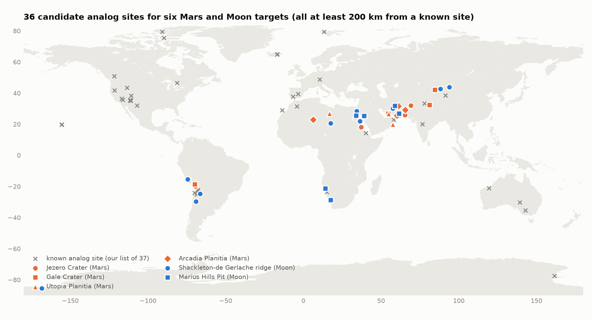

# Analog Atlas

**Where on Earth is most like a Mars or Moon landing site, why, and where does the comparison break down?**

Built by **Team Sol** for the **2026 NASA International Space Apps Challenge**, challenge [*Earth Analogs for Lunar and Martian Exploration*](https://www.spaceappschallenge.org/2026/challenges/).

**[Open the live app](https://analogatlasss.netlify.app)** (backup: [GitHub Pages](https://yos-ww.github.io/earth-analogs/web/)) · **[Read the write-up](docs/writeup.md)**




## Problem → solution

**Problem.** Before rovers and astronauts go to Mars or the Moon, teams test equipment and procedures at Earth sites that resemble the landing site. Those "analog" sites are mostly picked by eye and by tradition, so the same few (Atacama, Iceland, Hawaii, Antarctica) get used again and again, and it is rarely spelled out *in what way* a place resembles the target and in what way it does not.

**Solution.** Analog Atlas scores **every land cell on Earth (344,354 cells of 0.25°, about 28 km across)** against six real Mars and Moon sites: the Jezero, Gale and Zhurong (Utopia Planitia) rover sites, a human-landing candidate in Arcadia Planitia, the Artemis region at Shackleton crater, and the Marius Hills lava-tube skylight. It uses **12 measurements in 8 dimensions** (terrain, temperature, vegetation, aridity, albedo, surface snow/ice, dust and rock type), built from NASA satellite data for both Earth and the planetary targets. Because each dimension is scored separately, the app can show *why* a place matches and *where the analogy breaks down*.

**Does it work?** We tested the method on 37 analog sites scientists already use. Known Mars analogs rank above 90% of Earth's land, against 72% for random barren land (p ≈ 0.005, area-weighted permutation test). The method then proposes **54 candidate sites at least 200 km from any known analog**. The strongest cluster is a belt across south-east Iran and south-west Pakistan (Makran, Chagai, Hormozgan), which holds the top candidate for four of the six targets. Full method, validation and sensitivity analysis: [`docs/writeup.md`](docs/writeup.md).

## Features

- **Interactive 3D globe.** Pick a Mars or Moon site and Earth glows where it is similar. Every score is recomputed live in the browser from compact 8-bit feature arrays.
- **Click any land** for a score out of 100, what the place is good for practising, where it differs, and every underlying number compared with all six targets.
- **Dimensional analysis.** Tick one or more dimensions (e.g. dust, or terrain and rock) to see which places match on just those, with a live top 5.
- **Candidates and known sites on the map.** Cyan dots are our 54 finds, labelled from a first-pass literature check. Red dots are known analog sites, the test: if the method works, they should glow too.
- **"Does it work?" panel** with the validation results, and **mission cards** for each target: what is happening there, what teams must test on Earth first, and what Earth can never copy (gravity, air pressure, radiation).
- **50-second guided tour** (the ▶ Tour button, or add `?tour=1` to the address).
- **Phone layout** with a draggable bottom sheet. The app works best on a desktop browser.
- **Reproducible science pipeline:** one command per step turns 15 GB of raw satellite data into the app's data files. Rebuilding gives bit-identical outputs, and the test scripts check the scoring, terrain maths and exported files.

## Tech stack

- **App:** plain HTML, CSS and JavaScript (ES modules), no build step. [globe.gl](https://github.com/vasturiano/globe.gl) (three.js / WebGL) and topojson-client from a CDN.
- **Pipeline:** Python 3.12 with NumPy, SciPy, pandas, GDAL/rasterio and pyhdf (MODIS HDF4), xarray/netCDF4/h5py, GeoPandas, matplotlib and earthaccess for NASA Earthdata downloads. Linted and formatted with ruff.
- **Hosting:** Netlify (static), with GitHub Pages as a backup.

## Run it locally

The app is a static site. It needs a WebGL-capable browser and an internet connection (globe.gl, topojson-client and the fonts load from CDNs). Everything else is in the repo, including the generated data.

```bash
git clone https://github.com/yos-ww/earth-analogs.git
cd earth-analogs
python3 -m http.server 8000
```

Then open <http://localhost:8000/web/>. Any static file server works. Opening `web/index.html` straight from disk does not, because browsers block module scripts and `fetch` on `file://` URLs.

### Rebuild the data (optional)

You only need this to change the science. It needs about 15 GB of disk space and a free [NASA Earthdata login](https://urs.earthdata.nasa.gov/users/new). In your Earthdata profile, under *Applications → Authorized Apps*, approve **"NASA GESDISC DATA ARCHIVE"**, or the GPM download fails.

macOS's system Python is too old and Homebrew's GDAL cannot read MODIS HDF4 files, so use micromamba with conda-forge:

```bash
micromamba create -n analogs -c conda-forge -y \
  python=3.12 gdal libgdal-hdf4 libgdal-hdf5 libgdal-netcdf pyhdf \
  rasterio rioxarray xarray netcdf4 h5netcdf h5py \
  numpy scipy pandas geopandas shapely pyproj scikit-learn \
  earthaccess matplotlib tqdm
micromamba activate analogs
python -c "import earthaccess; earthaccess.login(strategy='interactive', persist=True)"  # saves the login to ~/.netrc

python setup/download_earthdata.py          # MODIS and GPM IMERG -> data/raw/
python setup/download_other.py              # GMTED, MOLA, LOLA, Diviner; add --check to only verify sizes

python -m pipeline.features                 # land mask + 12 features -> data/interim/  (about 2 minutes)
python -m pipeline.targets                  # terrain and basalt emissivity at the targets, from MOLA/LOLA
python -m pipeline.export                   # -> web/data/ (cells, features, meta, targets, known analogs)
python -m pipeline.score --validate         # -> web/data/validation.json
python -m pipeline.candidates               # -> web/data/candidates.geojson
python -m pipeline.figures                  # -> docs/figures/ (checks its numbers against validation.json)
python -m pipeline.sensitivity              # validation under changed choices
```

Checks: `python -m pipeline.test_score`, `test_terrain`, `test_candidates`, `test_export` and `test_landmarks` (the last needs `data/raw/`). Each script prints what it checked and exits non-zero on failure. The formats of the files in `web/data/` are specified in [`docs/contract.md`](docs/contract.md).

## Data sources

| Body | Dataset | Used for |
|---|---|---|
| Earth | NASA MODIS Terra MOD11C3 v061 | Day and night land-surface temperature; 8.55 µm emissivity (rock type) |
| Earth | NASA MODIS Terra MOD13C2 v061 | Vegetation (NDVI) |
| Earth | NASA MODIS MCD43C3 v061 | Surface albedo |
| Earth | NASA MODIS Terra MOD10CM v61 | Snow and ice cover; land mask |
| Earth | NASA MODIS Terra MOD08_M3 v6.1 | Dust (aerosol optical depth) |
| Earth | NASA GPM IMERG monthly V07 | Precipitation (aridity) |
| Earth | USGS GMTED2010 | Elevation, for relief, roughness and slope |
| Mars | NASA MGS MOLA MEGDR (PDS) | Terrain at the Mars targets |
| Mars | Mars Climate Database v6.2 (LMD/ESA/CNES) | Temperature, albedo, dust and frost at the Mars targets |
| Moon | NASA LRO LOLA (PDS) | Terrain at the Moon targets |
| Moon | NASA LRO Diviner (PDS) | Temperature at Shackleton and Marius Hills |

Globe imagery: NASA Blue Marble and Black Marble. Known analog sites and literature values, each with its source: [`data/known_analogs.csv`](data/known_analogs.csv), [`data/targets_literature.csv`](data/targets_literature.csv). Processing details per dataset: [`docs/writeup.md`](docs/writeup.md#data). The full list of agency resources offered by the challenge: [`data-sources.md`](data-sources.md).

## Known limitations and next steps

- **Novelty is not yet proven.** "No analog study found" means none turned up in a first-pass search of titles and abstracts ([`docs/literature-check.md`](docs/literature-check.md)). *Next:* a full Google Scholar and NASA ADS search, then field photos and geological maps for the top candidates.
- **The Moon result is inconclusive.** There are too few independent lunar analog sites to validate the Moon targets, so we make no claim there. For Mars, the result holds for Jezero and Arcadia on their own; Gale is borderline and Utopia does not pass. The tests are not corrected for multiple comparisons. *Next:* more lunar analog sites, especially outside the USA.
- **Satellite rainfall can't tell dry from extremely dry deserts**, so the aridity dimension barely separates candidates. The app flags this. *Next:* a soil-moisture or station-based dryness index.
- **The score can't see everything:** biology, caves and lava tubes, buried or shadowed ice, metre-scale texture and practical access are not measured. Nor can any place on Earth reproduce Mars or Moon gravity, air pressure or radiation; the app states these limits for every target instead of scoring them.
- **Temperature never matches.** Every Mars and Moon site is colder than anywhere on Earth, so the candidates match on terrain, albedo, dust, rock type and bare ground, not on temperature.
- **Moon albedo is a single global mean** for both lunar sites. *Next:* site-specific values, plus new dimensions such as radar roughness, which exists for both Earth and the Moon.
- **The app needs WebGL and an internet connection** for its CDN libraries. *Next:* a flat-map fallback, and a form for mission teams to enter their own target site.
- **The checks are standalone scripts**, not a test framework, and there is no CI.

## Repository layout

| Path | What |
|---|---|
| `web/` | The app: `index.html`, `app.js` (globe and panel), `score.js` (live scoring, mirrors `pipeline/score.py`), `tour.js`, `missions.js`, `regions.js`, `places.js`, `style.css` |
| `web/data/` | Data generated by the pipeline (do not edit by hand) |
| `pipeline/` | Features, targets, scoring, validation, candidate search, export, figures and the test scripts |
| `setup/` | Download scripts for the raw NASA and USGS data |
| `data/` | Known analog sites, cited planetary target values, country polygons |
| `docs/` | Write-up, data-format contract, literature check, figures |
| `challenge.md` | The challenge statement |

## Team Sol

| | Role |
|---|---|
| **Yosif** ([@yos-ww](https://github.com/yos-ww)) | Data and science: data acquisition, feature pipeline, scoring method, validation and sensitivity analysis, candidate search, method sections of the write-up |
| **Serdar** ([@birbaskagezgin](https://github.com/birbaskagezgin)) | App and story: the 3D globe app, mission cards and tour, planetary target values from the literature, the known-analog list, the literature check of candidates, and the pitch |

<!-- TODO: add LinkedIn profile links for both team members. -->

Some docs refer to "A" (data and pipeline, Yosif) and "B" (app, Serdar), from how we split the work during the hackathon.

## License

- **Code** (`pipeline/`, `setup/`, `web/` except `web/data/` and `web/img/`): [MIT](LICENSE).
- **Write-up, docs, figures and the generated data in `web/data/`:** [CC BY 4.0](https://creativecommons.org/licenses/by/4.0/). Reuse them freely, with credit to Team Sol (Analog Atlas).
- **Third-party data and images keep their own terms.** NASA and USGS data and imagery (MODIS, GPM IMERG, GMTED2010, MOLA, LOLA, Diviner, Blue Marble, Black Marble) and Natural Earth are public domain or free to use with credit. The Milky Way background is © ESO/S. Brunier, [CC BY 4.0](https://creativecommons.org/licenses/by/4.0/). Mars Climate Database values and published values are cited where they are used (`data/targets_literature.csv`). globe.gl (MIT) loads from a CDN and is not part of this repo.
