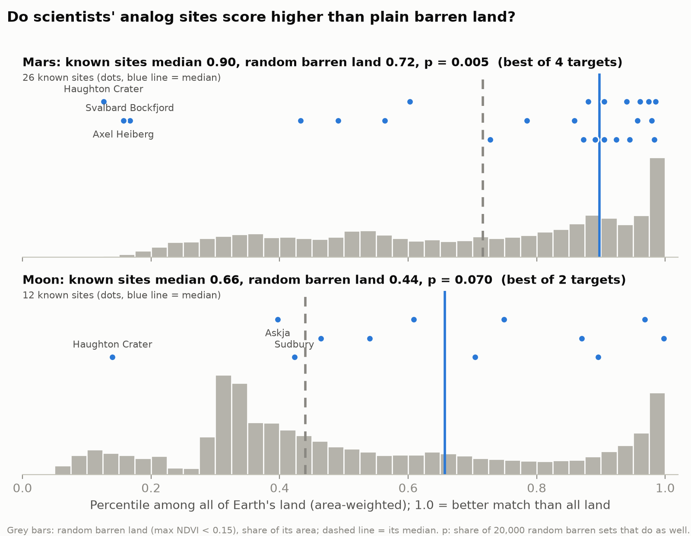
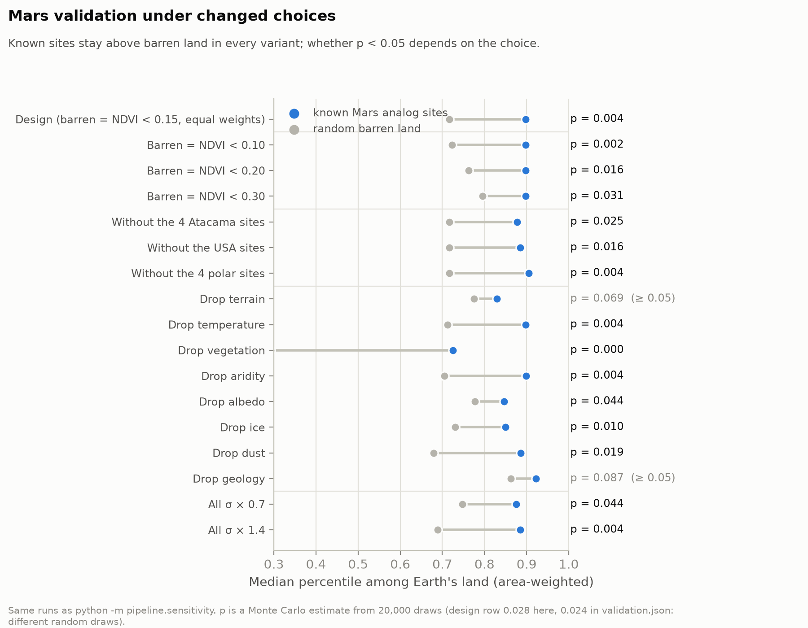
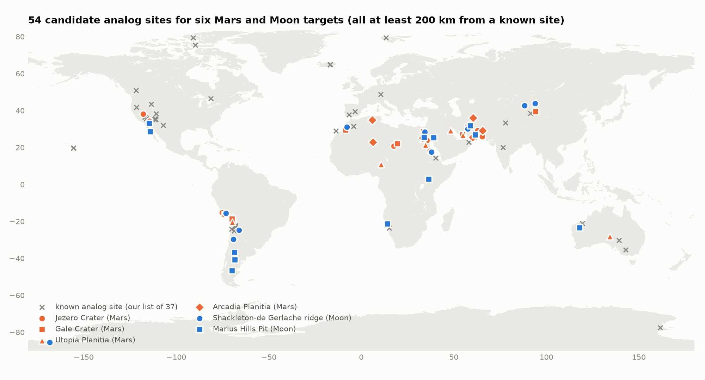

# Analog Atlas: a global search for Earth's analogs of Moon and Mars landing sites

> **Draft, 2026-11-14.** Sections marked **(B)** are Person B's (Summary, problem and idea, Earth's limits, how to use and next steps; deep dive in progress). Sections marked **(A)** are written from the generated files in `web/data/`; every number can be reproduced with the commands in "Reproduce". Numbers will change if the data or target values change, so re-check them at the data freeze.

## Summary (B)

**The problem.** Before astronauts land on Mars or the Moon, teams test rovers, drills, instruments and procedures in places on Earth that resemble the landing site. Those analog sites are usually chosen because they look the part, and the same few (Atacama, Iceland, Hawaii, Antarctica) are used again and again.

**What we built.** Analog Atlas compares **every place on Earth's land, 344,354 patches about 28 km across**, with six real Mars and Moon sites: the Jezero, Gale and Zhurong rover landing sites, a human-landing candidate in Arcadia Planitia, the Artemis region at Shackleton crater, and a lava-tube skylight in the Marius Hills. It uses **twelve measurements in eight dimensions**: terrain, temperature, plants, rainfall, ground brightness, ice, dust and rock type, from NASA MODIS, GPM, USGS, MGS, LRO and the Mars Climate Database. For each place it says how similar it is, **what matches, and where the analogy breaks down**. Everything runs in an interactive 3D globe with a guided tour: **https://yos-ww.github.io/earth-analogs/web/**

**What we found.** 54 candidate sites, all at least 200 km from any analog on our list. The biggest surprise is a belt across **south-east Iran and south-west Pakistan** (the Makran coast, the Chagai–Registan deserts and the Hormozgan salt domes). It holds the top candidate for four of the six targets. The best match for Curiosity's Gale crater is **about 355 km from Doha**, among the Hormozgan salt domes.
- Salt glaciers like these have been compared with Mars in conference work, but our first-pass literature search found no field analog study at this site.
- For the Makran and Chagai parts of the belt, that search found no analog study at all.
- A deeper search is still needed before calling any of it unrecognised.

**Does it work?** We tested the method on 37 places scientists already use. Known Mars analogs rank above plain desert: better than 90% of Earth's land, against 72% for random barren land (p ≈ 0.005). The result holds for Jezero and Arcadia on their own, but not for Utopia, and it is not corrected for testing several targets. For the Moon there are too few independent sites to conclude, and we make no claim.

**Where it breaks down.**
- The score cannot see life, caves, buried ice or practical access.
- Satellite rainfall is too coarse to tell dry from extremely dry deserts.
- No place on Earth copies the gravity (38% of Earth's on Mars, 17% on the Moon), the thin or missing air (under 1% of Earth's pressure on Mars) or the radiation (about 100 times Earth's surface dose on Mars, 200 times on the Moon).

The atlas is a shortlist for the rest: a way for analog-programme planners, and for countries without an analog site of their own, to find where to test next.

## The problem and our idea (B)

**Why analogs matter.** A rover, drill or spacesuit that fails on Mars or the Moon cannot be repaired. So missions rehearse on Earth first, in deserts, polar regions, volcanic fields and impact craters that share some of the landing site's conditions. Apollo astronauts trained in Iceland and at Meteor Crater. NASA tested Curiosity's driving on the Mojave dunes. Life-detection instruments are tried in the Atacama.

**The problem.** Analog sites are mostly chosen by eye, by tradition and by access: a place "looks like Mars" and has a research station nearby. The result is a short list of famous sites that are studied again and again. The challenge asks for something different: a systematic, data-driven search of the whole Earth that explains **what makes a place analogous and where the analogy breaks down**, and that looks beyond the well-known sites.

**Our idea.** Start from the planet, not from Earth.
1. **Describe each Mars and Moon site with numbers.** We take six real sites (three rover landing sites, a human-landing candidate, the Artemis south-pole region and a lava-tube skylight) and describe each one on twelve measurable properties: terrain, temperature, plants, rainfall, ground brightness, ice, dust and rock type. The values come from Mars and Moon missions and models.
2. **Measure the same properties everywhere on Earth** from NASA satellite data, for 344,354 patches about 28 km across.
3. **Score every patch, one property at a time.** The answer is never just "similar": it says which properties match and which do not. Where a Mars or Moon value lies beyond anything on Earth (every Mars night is colder than Earth's coldest), we score "as close as Earth gets" and flag it.
4. **Test the method before trusting it.** If the score is meaningful, places scientists already use should rank higher than random plain desert. We fixed the method before looking at any result and report the test as it came out.
5. **Look for new places and check them.** Candidate sites far from known analogs are checked against the literature before we call them new.

**What is new.** Comparisons like this are usually made one site and one property at a time. Analog Atlas does it for all of Earth's land at once, for several targets, with every number traceable to a public dataset. It also turns the result into something a mission planner or a student can use in a few clicks: a 3D globe that shows where to go, why, and what will not match.

---

## Data (A)

All Earth data are open NASA or USGS products; Mars and Moon data are NASA Planetary Data System (PDS) products. Raw files (about 15 GB) are not in the repository; `setup/` downloads them and checks their sizes.

| Dataset | Used for | Period and resolution | Processing |
|---|---|---|---|
| MODIS Terra MOD11C3 v061 | Day and night land-surface temperature; emissivity at 8.55 µm (band 29) | Monthly, 2021–2023 (36 files), 0.05° | Calendar-month climatology, then coldest or warmest month; emissivity: median of 36 months |
| MODIS Terra MOD13C2 v061 | Vegetation (NDVI) | Monthly, 2022–2023 (24 files), 0.05° | Per-pixel maximum over 24 months |
| MODIS MCD43C3 v061 | White-sky shortwave albedo | The 15th of each month of 2023 (12 files), 0.05° | Per-pixel median of the valid days |
| MODIS Terra MOD10CM v61 | Snow and ice cover; also the land mask | Monthly, 2021–2023 (35 files; October 2022 missing), 0.05° | Mean of calendar-month means over months with data (at least 6) |
| MODIS Terra MOD08_M3 v6.1 | Aerosol optical depth (dust) | Monthly, 2023 (12 files), 1° | Deep Blue AOD at 550 nm over land, mean of months |
| GPM IMERG monthly V07 | Precipitation | Monthly, 2021–2023 (36 files), 0.1° | Mean rate × 8766 h per year |
| USGS GMTED2010 | Elevation, for relief, roughness and slope | 30 arc-second mean elevation (about 0.93 km), 84°N to 90°S | See "Terrain on one ground scale" |
| MGS MOLA MEGDR | Mars terrain at the targets | 64 pixels per degree (926 m) | Same window and formulas as Earth |
| LRO LOLA gridded data | Moon terrain at the targets | 64 pixels per degree (474 m) and the 240 m south-polar grid | Averaged to about 926 m first, then as Earth |
| LRO Diviner polar resource product (south) | Day temperature at Shackleton | 2.88 million surface triangles | Median within the target window |
| LRO Diviner global cumulative averages (10°–20°N band) | Day and night temperature at Marius Hills | Mission-average bolometric temperature, 0.25-hour local-time bins, 0.5° tiles | Tiles inside the target window, interpolated to 10:30 and 22:30 local time |
| Mars Climate Database v6.2 (B) | Mars temperature, albedo, dust opacity and surface frost at each target | Climatology average solar scenario, 12 months at 10:30 and 22:30 local time | Values read at each target point |

Terra crosses the equator at about 10:30 local time (day) and 22:30 (night). Mars day and night values were taken at the same two local times so that Earth and planetary temperatures are comparable.

## Method (A)

### Grid and land mask

The grid is global, 0.25° (1440 × 720 cells). A 0.05° MODIS pixel counts as land if MOD10CM never flags it as water (the flag is identical in all months). A 0.25° cell is land if at least half of its 5 × 5 sub-pixels are land. This gives **344,354 land cells**, including Antarctica and Greenland and excluding lakes. Cells are not equal in area: every percentile, ranking and validation figure below uses weights proportional to cos(latitude), because otherwise the Arctic and Antarctica would be over-counted.

### Twelve features in eight dimensions

Features are averaged within a dimension before the dimensions are combined, so a dimension with three features does not count three times.

| Dimension | Feature | Definition | Earth range, p1 to p99 |
|---|---|---|---|
| Terrain | Relief | Maximum minus minimum elevation in the window | 11 to 2,696 m |
| | Roughness | Standard deviation of elevation in the window | 1.9 to 594 m |
| | Slope | Mean slope in the window | 0.04 to 13.4° |
| Temperature | Warmest-month day temperature | Warmest of 12 monthly means, day overpass | 241 to 327 K |
| | Coldest-month night temperature | Coldest of 12 monthly means, night overpass | 207 to 295 K |
| | Day–night range | Mean over months of (day − night) | 0.4 to 25 K |
| Vegetation | Maximum NDVI | Yearly maximum, clipped to 0–1 | 0 to 0.89 |
| Aridity | Precipitation | Mean annual precipitation | 0 to 3,442 mm/yr |
| Albedo | White-sky shortwave albedo | Median of valid sampled days | 0.10 to 0.84 |
| Ice | Snow and ice cover | Mean fraction of the year with snow or ice on the surface | 0 to 1 |
| Dust | Aerosol optical depth | Deep Blue AOD at 550 nm | 0.02 to 0.67 |
| Geology | Emissivity at 8.55 µm | Median of 36 monthly values | 0.77 to 0.98 |

"p1 to p99" is the area-weighted range of Earth land values. Notes on the less obvious choices:

- **Temperatures** are monthly means (the 3 years are first averaged for each calendar month), not single-day extremes, because that is what the planetary values are. A pixel needs data in at least 6 of the 12 months. Where winter months are missing (polar night, persistent cloud) the coldest-night and range values are bounds, not measurements.
- **Geology** is the 8.55 µm emissivity: low (about 0.75) for quartz-rich sand seas, high (0.95 to 0.98) for basalt, but also high for vegetation and ice. It is a silica index, not a mineral map, and it must be read together with NDVI and snow cover.
- **Snow and ice** counts only codes 0–100 of the snow product; night, cloud and fill codes are missing data, never zero. In the Arctic, polar-night months are missing, so values describe the sunlit season and read low.
- **Albedo** needs at least 4 of the 12 sampled days; **aerosol** needs at least 4 of 12 months and is not retrieved over ice.
- Skewed features (relief, roughness, slope, precipitation) are put on a log(1 + x) scale before scoring. All features are stored as 8-bit values after that, so the browser can re-score live.
- Values at 0.05° (or 0.1°, 1°) are averaged to the 0.25° cell over their valid land pixels.

### Terrain on one ground scale

Terrain depends on the size of the window, and a 0.25° cell is 28 km wide at the equator but only 9.5 km at 70°N. To compare Earth with other bodies and with itself at every latitude, terrain is always measured in a window about 28 × 28 km on the ground (±13.9 km). For Earth, a cell's 30 elevation rows (27.8 km north to south) are its latitude band and the window is 30 / cos(latitude) pixels wide, so it is about 28 km wide everywhere. Slope is a central difference in ground metres whose baseline is about 1.9 km in both directions (one pixel north-south, round(1 / cos latitude) pixels east-west). The same formulas run on Mars (MOLA, 926 m pixels) and the Moon (LOLA averaged to about 926 m first; the south pole uses projected x and y metres). Checks: a tilted plane with a known 5.711° slope is recovered exactly at 0°, 40°, 65° and on the polar grid, and the target-side code agrees with the Earth-cell arrays at six real places (for example Kansas, 15 vs 15 m roughness; Alps within 2%).

### The six targets

Each target is one point, a measured landing site or candidate, with a value for each feature and a source. Terrain is computed from MOLA and LOLA; everything else comes from the literature or models. Values marked ↓ or ↑ lie beyond anything measured on Earth's land (below the minimum or above the maximum of the 344,354 cells), so no place on Earth can match them. They are scored like every other value: the further beyond Earth's range, the lower every Earth cell scores (Jezero's night is only 1 K beyond it, so Earth's coldest cells still match; the lunar values are far beyond, so nothing does).

| Target | Relief m | Rough. m | Slope ° | Day K | Night K | Range K | Albedo | Dust | Frost | Emis. |
|---|---|---|---|---|---|---|---|---|---|---|
| Jezero Crater (Mars) | 1,161 | 280 | 2.7 | 268 | 196 ↓ | 55 ↑ | 0.171 | 0.50 | 0 | 0.952 |
| Gale Crater (Mars) | 4,396 | 831 | 5.1 | 274 | 189 ↓ | 63 ↑ | 0.236 | 0.59 | 0 | 0.952 |
| Utopia Planitia (Mars) | 177 | 41 | 0.4 | 263 | 187 ↓ | 50 ↑ | 0.231 | 0.54 | 0 | 0.952 |
| Arcadia Planitia (Mars) | 854 | 158 | 2.1 | 268 | 166 ↓ | 62 ↑ | 0.238 | 0.43 | 0 | 0.952 |
| Shackleton rim (Moon) | 4,741 | 1,161 | 15.2 | 240 | 90 ↓ | n/a | 0.11 | n/a | 0 | n/a |
| Marius Hills pit (Moon) | 443 | 84 | 1.2 | 381 ↑ | 105 ↓ | 276 ↑ | 0.11 | n/a | 0 | 0.952 |

Vegetation (NDVI) and precipitation are 0 for every target (no vegetation, no rainfall). Sources:

- **Mars temperatures, albedo, dust and frost:** Mars Climate Database v6.2, climatology average solar scenario, queried at each target point for 12 months (Ls 15° to 345°) at 10:30 and 22:30 local time, the Terra overpass times. Day = surface temperature at 10:30 in the warmest month; night = at 22:30 in the coldest month; range = yearly mean of (10:30 − 22:30). Albedo is the model's TES-derived bolometric ground albedo. Dust is the yearly mean of the monthly visible dust opacity, used at 550 nm without conversion: Martian dust grains (about 1.5 µm) make the extinction nearly flat across visible wavelengths. Surface CO₂ and H₂O frost is zero in all 12 months at all four points. As a check, the same query at the Viking 2 site (47.7° N) gives 0.74 kg/m² of CO₂ frost in winter, where the lander photographed frost.
- **Moon:** Marius Hills temperatures from the Diviner global cumulative product (J.-P. Williams, UCLA; the dataset behind Williams et al. 2017, Icarus 283:300–325): the mission-average bolometric temperature of the two 0.5° tiles inside the target window, interpolated to 10:30 local time (day, 381 K) and 22:30 (night, 105 K), the Terra overpass times; the range is their difference (276 K). The table has no seasons, so these are mission averages, not warmest- or coldest-month values. The peak and trough of the same profile are 392 K and 94 K, which is what the earlier literature-based values (390 K and 95 K) represented. Shackleton night temperature from a secondary summary of Diviner results (90 K; Earth's coldest cell is 197 K, so every Earth cell scores close to 0 on it). Shackleton day temperature is the median Diviner annual-maximum surface temperature of 4,729 triangles within ±13.9 km, which is an upper bound against Earth's monthly-mean convention. The Diviner table has no day or night values, so Shackleton's day–night range is n/a. Albedo 0.11 is the global mean lunar Bond albedo (NASA NSSDC fact sheet) and is a placeholder for site values.
- **Geology:** the basaltic targets get the 8.55 µm emissivity that MODIS measures on two barren Earth basalt flows (Holuhraun 0.955, Black Point 0.950, mean 0.952), so the target and Earth come from the same sensor. Shackleton is feldspathic highland, for which there is no Earth reference, so geology is skipped for it. Both reference flows are also validation sites, so the test is slightly circular for them. Leaving them out changes little for Mars (known-site median 0.905 vs 0.898, p = 0.004 either way) and weakens the Moon result (0.609 vs 0.657, p = 0.14 vs 0.07).
- **Terrain at Gale** is dominated by Mount Sharp. The landing site lies on the crater floor, but the south-east corner of its 28 km window climbs the mountain's flank to about 4.3 km above it, so Gale's relief (4,396 m) and roughness (831 m) describe the crater-and-mountain setting, not the plains the rover landed on. Earth cells use the same square window, so the comparison is consistent.
- **Ice** is surface snow or frost only. Arcadia's shallow ground ice and the ice in Shackleton's shadowed craters are below or off the surface and are described in the mission text, not scored.

### Scoring

For one target and one cell, work in the transformed space (log(1 + x) for the skewed features). With f the cell value, t the target value and σ a robust spread of the Earth values (interquartile range ÷ 1.35, area-weighted):

- **Like-for-like, for every feature:** the feature score is exp(−((f − t) / σ)²), 1 for a perfect match and falling towards 0.
- **A target beyond Earth's range is not rewarded.** If the target is colder than any Earth place, even Earth's coldest cell scores low on that feature, because it is not a match. The app flags such features as "beyond Earth". This rule replaced an earlier one-sided rule on 2026-11-15; see "Choices, and when they were made".
- A feature that is missing in a cell is **skipped** and the weights are renormalised; a feature that has no meaning for a target is n/a.
- A dimension's score is the mean of its features. The overall score is the weighted mean of the dimensions (default weights all equal; the user can change them), and a cell is scored only if at least 4 dimensions have data.

σ has a floor of 5% of the p1-to-p99 range so a mostly-constant feature cannot get σ = 0; the floor never binds for any of the twelve features. The browser and Python versions give the same numbers: 306 cells, including cells with missing data, are compared after every data change (tolerance 10⁻⁴).

### Choices, and when they were made

The design below was fixed before any result was seen: the grid, the twelve features and eight dimensions, the scoring formula, the σ rule, equal default weights, area weighting, the fixed 28 km terrain window, the validation design and the barren-land baseline. We did not tune any of it to improve a result. One part of the original design, the one-sided scoring rule, was changed after results were seen; it is item 5 below.

Choices made after a first look at results, listed so they can be judged:

1. The basaltic emissivity target changed from a placeholder (0.96) to 0.952 from Earth basalt flows. B proposed the rule before any result existed. It moved the validation figures slightly in the favourable direction.
2. Candidates: regions need at least 3 cells; large regions are split at local maxima 200 km apart; kept candidates are at least 400 km apart (150 km at first) and need robustness of at least 0.25. These shape which places are shown and do not affect validation.
3. Shackleton's day–night range was set to n/a rather than filled with a different quantity.
4. Aridity was kept as designed after we found it nearly uninformative (see "What the dimensions show"). Lowering its weight would have been tuning to the answer; dropping it moves the Mars result only slightly (0.90 vs 0.75, p = 0.017, Figure 2). The app marks it as limited by the rainfall data instead. Decided by both, 2026-11-14.
5. **The one-sided ("directional") scoring rule was removed on 2026-11-15, after all results had been seen.** The original design scored a feature one-sided when the target lay outside Earth's p1 to p99 range: every cell beyond that end scored 1. A new view in the app (scoring on one dimension at a time) showed that this gave false perfect matches. Shackleton's slope (15.2°) is inside Earth's range (maximum 25.2°), yet every slope above 13.4° scored 1, including 25° slopes. Where Earth cannot match at all (Mars day–night range, lunar temperatures), Earth's most extreme 1% also scored 1. Every feature is now scored like-for-like. We made the change because the rule was wrong, not to improve a result, but it did change the results, in both directions, so both sets are given:

   | | Old rule: known vs barren, p | New rule: known vs barren, p |
   |---|---|---|
   | Mars, best of 4 | 0.89 vs 0.76, 0.024 | 0.90 vs 0.72, 0.005 |
   | Moon, best of 2 | 0.70 vs 0.57, 0.210 | 0.66 vs 0.44, 0.070 |
   | Jezero | 0.87 vs 0.56, 0.002 | 0.87 vs 0.49, 0.0004 |
   | Arcadia | 0.89 vs 0.79, 0.063 | 0.89 vs 0.76, 0.031 |
   | Gale | 0.86 vs 0.77, 0.097 | 0.86 vs 0.74, 0.052 |
   | Utopia | 0.87 vs 0.79, 0.080 | 0.81 vs 0.77, 0.240 |
   | Marius Hills | 0.73 vs 0.60, 0.199 | 0.68 vs 0.45, 0.055 |
   | Shackleton | 0.67 vs 0.57, 0.194 | 0.61 vs 0.65, 0.822 |

   The candidate list also changed: 30 of the 55 earlier candidates are unchanged, 5 moved by less than 150 km, and 19 of the 54 current candidates are new places. The first-ranked candidates for Jezero, Gale, Utopia and Shackleton are the same cells as before. A reader who distrusts a change made after the fact should use the old-rule column.

## Validation (A)

### Design

The known analog sites (`data/known_analogs.csv`, 37 published sites) are the test of the method, not its product. If the score is meaningful, scientists' analogs should rank high on it, and clearly higher than a naive baseline that just picks dry, barren land. Rules:

- **Percentiles.** A site's score is converted to an area-weighted percentile among all scored land cells (1.0 = better than all of Earth's land). A random land cell has a median percentile of 0.50; every run checks this and stops if it is off.
- **Own body only.** A site is scored only against targets of the body it is an analog for (Mars sites against the four Mars targets, Moon sites against the two Moon targets). In the per-target rows of the table a site's score is its score for that one target. In the per-body rows it is the best over the body's targets, and the random baselines also take the best over the same set, so taking the best does not inflate the comparison.
- **Baseline: random barren land.** Cells with maximum NDVI below 0.15 (36,189 cells), the "just pick a desert" strategy. The threshold sits above zero because the yearly maximum picks up noise: bare sand reads 0.09 to 0.13 (Libyan Great Sand Sea 0.128, Lut 0.091).
- **Which sites count.** Sites tagged with at least one scored dimension (`mineralogy` counts as geology) are tested. Sites tagged only biology, operations or subsurface (Lava Beds, Mauna Loa HI-SEAS, Pavilion Lake) are not visible to the score and are reported separately.
- **Significance.** p is the share of 20,000 random barren sets of the same size (cells drawn with probability proportional to area) whose median percentile is at least the observed one. It is a Monte Carlo estimate with an error of about ±0.003.

### Results

| | Sites | Known sites (median percentile) | Random barren land | p |
|---|---|---|---|---|
| **Mars**, best of 4 targets | 26 | **0.90** | 0.72 | **0.005** |
| **Moon**, best of 2 targets | 12 | **0.66** | 0.44 | 0.070 |
| Jezero alone | 26 | 0.87 | 0.49 | 0.0004 |
| Arcadia alone | 26 | 0.89 | 0.76 | 0.031 |
| Gale alone | 26 | 0.86 | 0.74 | 0.052 |
| Utopia alone | 26 | 0.81 | 0.77 | 0.240 |
| Marius Hills alone | 12 | 0.68 | 0.45 | 0.055 |
| Shackleton alone | 12 | 0.61 | 0.65 | 0.822 |

Reading: **known Mars analogs rank above random barren land** (the median known site is better than 90% of Earth's land, against 72% for the typical barren cell; p ≈ 0.005). For Jezero on its own the evidence is strong (p = 0.0004), and Arcadia is significant at 0.05 (p = 0.03). Gale is borderline (p = 0.05) and Utopia is not significant (p = 0.24). For the Moon as a body the sites are in the right direction (p = 0.07), but there are only 12, and the two targets disagree: Marius Hills is borderline (p = 0.06), while for Shackleton the known sites rank slightly below random barren land (0.61 vs 0.65). Shackleton's temperatures are beyond anything on Earth, so its score rests on terrain, albedo and the three zero-valued features, and we make no claim for it. Counting every site of the body, including those the score cannot see, gives similar figures (for example Jezero 0.84 with 29 sites). These numbers are from the like-for-like rule adopted on 2026-11-15; the earlier numbers are in "Choices, and when they were made", item 5.



*Figure 1. Each dot is a known analog site, placed at its percentile among all of Earth's land for the best-matching target of its body. Grey bars: random barren land, by share of its area. The lowest Mars sites are the Arctic ones (Haughton, Axel Heiberg, Svalbard), which are snow-covered while the Mars targets have no surface frost.*

### What the dimensions show

Median percentile of the dimension score, for sites tagged with that dimension and for random barren cells (Jezero shown; Gale and Arcadia are similar except terrain):

| Dimension | Sites tagged | Known sites | Random barren land |
|---|---|---|---|
| Terrain | 10 | 0.83 | 0.41 |
| Temperature | 4 | 0.61 | 0.19 |
| Aridity | 7 | 0.87 | 0.85 |
| Geology | 15 | 0.57 | 0.07 |
| Ice | 3 | 0.11 | 0.51 |
| Dust | 3 | 0.21 | 0.71 |

- **Terrain and temperature separate known sites from barren land.** Terrain is the strongest signal. On temperature, barren land ranks low (0.19) because most of it is hot desert, far from Mars temperatures. For Utopia (the flattest target) the sign reverses (known 0.30 vs barren 0.54): known analogs are rougher than a flat plain, which is why Utopia alone is not significant.
- **Aridity does not separate them, and is nearly uninformative.** This is a limit of the rainfall data, not a finding about deserts. IMERG at 0.1° overestimates desert rainfall: it reads 45 mm/yr at Atacama Yungay (the standard hyperarid analog, in reality a few millimetres), 56 mm/yr at the core of the Lut desert and 122 mm/yr at Death Valley. Against a target of 0 mm/yr a cell scores 0.4 at 2 mm/yr, 0.09 at 5 mm/yr and 0.01 at 10 mm/yr, so only 6.8% of land area scores 0.1 or more, and almost every desert, including the best-known analog, scores close to 0. The dimension therefore mainly identifies the driest few percent of land (the Libyan Sahara, the Antarctic plateau) and says little beyond that. Its weight can be lowered in the app, and a better aridity measure would be the first thing to improve.
- **Geology: barren land is the worst match (0.07).** The basaltic targets match vegetation and ice (high emissivity) better than quartz-rich deserts, so the dimension must be read together with vegetation.
- **Ice and dust go the wrong way for the known sites, for understandable reasons.** The sites tagged ice (McMurdo Dry Valleys, Haughton Crater, Axel Heiberg) are snow-covered by definition, while every Mars target has no surface frost, so a surface-snow measure scores them poorly (decision: the dimension is "surface snow and ice", and Arcadia's ice is below the surface). Mars dust opacity (0.4 to 0.6) is higher than at Qaidam, Mojave and the Namib (0.2 to 0.3), so Earth's dustiest barren land matches best.

### How far to trust this

- **The evidence is modest and not robust to every choice.** p ≈ 0.005 for Mars with 26 sites; the sensitivity table below shows it ranges from below 0.001 to 0.09 under reasonable changes, and it was 0.024 under the scoring rule we replaced. Several sites are not independent (11 of the 37 are in the USA, four are in the Atacama region, and there are pairs in Hawaii and Iceland), and the p-values are not corrected for testing several targets and dimensions.
- **The site list was compiled by us** from published analog sites, before any scoring, and the tags (which dimension a site is known for) are our reading of the literature.
- **The Moon test is weak.** The Moon's analog sites are mostly Apollo-training sites chosen for crater shape or logistics (Ries, Sudbury, Lonar, Cinder Lake), many on vegetated or inhabited land. An environment score cannot be expected to rank them high.
- **The data was checked against the outside world, not only against itself** (`python -m pipeline.test_landmarks`). MOLA elevations at the Perseverance, Curiosity and Zhurong landing sites, read without the pipeline's code, are within 4 m of the published values. The MODIS aerosol and temperature files, read raw, are not flipped or shifted. Six Earth landmarks (Amazon, Libyan sand sea, Dome C, Everest, Bodélé, Yakutsk) fall in physically sensible ranges. An independent implementation of the scoring rules reproduces all 54 candidate scores. The two LOLA polar grids (240 m and 80 m) give the same Shackleton roughness (1,161 vs 1,163 m).
- **Early versions looked better and were wrong.** With five features and no target values for albedo or snow, the score rewarded ice sheets (percentile among barren land: McMurdo Dry Valleys 1.00, Holuhraun 0.99) and the tagged known sites scored a median of 0.75. Completing the features made the result more modest and more honest (McMurdo 0.42, Holuhraun 0.56, same measure).

### Sensitivity of the Mars result

`python -m pipeline.sensitivity` re-runs the Mars test with one choice changed at a time. It reports sensitivity; the design numbers above are not replaced by any variant. Known sites' median percentile vs random barren land's, and p:

| Change | Known vs barren | p |
|---|---|---|
| None (design) | 0.90 vs 0.72 | 0.004 |
| Barren = NDVI < 0.10 / 0.20 / 0.30 (design 0.15) | 0.90 vs 0.72 / 0.76 / 0.80 | 0.002 / 0.02 / 0.03 |
| Leave out any one site (26 runs) | 0.89 to 0.91 vs 0.72 | at most 0.01 |
| Leave out the 4 Atacama sites | 0.88 vs 0.72 | 0.03 |
| Leave out the 4 USA sites that are visible to the score | 0.89 vs 0.72 | 0.02 |
| Leave out the 4 polar sites | 0.91 vs 0.72 | 0.004 |
| Drop terrain (weight 0) | 0.83 vs 0.78 | 0.07 |
| Drop geology | 0.92 vs 0.86 | 0.09 |
| Drop albedo | 0.85 vs 0.78 | 0.04 |
| Drop ice / dust / aridity / temperature | 0.85 to 0.90 vs 0.68 to 0.73 | 0.004 to 0.02 |
| Drop vegetation | 0.72 vs 0.29 | < 0.001 |
| All σ × 0.7 / × 1.4 | 0.88 / 0.89 vs 0.75 / 0.69 | 0.04 / 0.004 |

The direction (known sites above barren land) holds in every variant, and p stays below 0.05 in all but two: dropping terrain (0.07) or geology (0.09), the dimensions that carry most of the separation. It does not depend on any single site or group of sites. Dropping vegetation makes the result much stronger because barren land matches the vegetation target (no plants) by construction, so comparing against barren land is a conservative test in that respect. For the Moon the result cannot be interpreted: with 6 of the 12 sites in the USA, removing them gives 0.52 vs 0.44 (p = 0.35), and the sign reverses when albedo is dropped (0.60 vs 0.80).



*Figure 2. The Mars result for each variant in the table (blue: known sites, grey: random barren land). The p values are a separate Monte Carlo run, so the design row reads 0.004 here and 0.005 in `validation.json`.*

## Results: new candidates (A)

For each target the pipeline takes the top 1% of land area, groups the cells into regions, splits large regions at their local maxima, removes anything within 200 km of a known analog and, for the Mars targets, permanent ice sheets, and ranks what is left by score × robustness. Robustness is the share of 500 random changes of the dimension weights (each multiplied by exp(N(0, 0.5))) in which the place stays in the top 50. At most 3 candidates per continent are kept, at least 400 km apart. The result is 54 candidates (`web/data/candidates.geojson`).



*Figure 3. Candidates by target (orange: Mars, blue: Moon) and the known analog sites used for validation (grey crosses).*

Top three for each target (score at the default equal weights; "weakest" shows where the analogy breaks down):

| Target | # | Best cell | Continent | Score | Robust. | Area km² | To nearest known | Weakest dimensions |
|---|---|---|---|---|---|---|---|---|
| Jezero | 1 | 25.9°N 65.4°E | Asia | 0.72 | 1.00 | 51,960 | 798 km | temperature 0.00, aridity 0.00 |
| Jezero | 2 | 25.9°N 60.4°E | Asia | 0.68 | 1.00 | 29,120 | 397 km | temperature 0.00, aridity 0.00 |
| Jezero | 3 | 29.1°N 62.9°E | Asia | 0.64 | 1.00 | 2,027 | 835 km | temperature 0.00, aridity 0.00 |
| Gale | 1 | 26.9°N 54.6°E | Asia | 0.68 | 1.00 | 14,441 | 570 km | temperature 0.00, aridity 0.00 |
| Gale | 2 | 18.6°S 69.9°W | South America | 0.60 | 1.00 | 15,393 | 455 km | temperature 0.00, aridity 0.00 |
| Gale | 3 | 39.4°N 94.1°E | Asia | 0.60 | 1.00 | 4,179 | 243 km | aridity 0.00, dust 0.00 |
| Utopia | 1 | 25.6°N 61.1°E | Asia | 0.70 | 1.00 | 23,694 | 424 km | temperature 0.00, aridity 0.00 |
| Utopia | 2 | 29.1°N 48.1°E | Asia | 0.70 | 1.00 | 4,035 | 1,221 km | temperature 0.00, aridity 0.00 |
| Utopia | 3 | 26.6°N 54.9°E | Asia | 0.68 | 0.98 | 8,959 | 533 km | temperature 0.00, aridity 0.00 |
| Arcadia | 1 | 25.6°N 60.1°E | Asia | 0.72 | 1.00 | 27,813 | 360 km | temperature 0.00, aridity 0.00 |
| Arcadia | 2 | 29.1°N 65.6°E | Asia | 0.72 | 1.00 | 32,490 | 1,014 km | temperature 0.00, aridity 0.00 |
| Arcadia | 3 | 36.1°N 60.4°E | Asia | 0.70 | 1.00 | 28,807 | 1,485 km | temperature 0.00, aridity 0.00 |
| Shackleton | 1 | 29.6°S 69.1°W | South America | 0.62 | 1.00 | 36,345 | 499 km | temperature 0.00, aridity 0.00 |
| Shackleton | 2 | 24.6°S 66.1°W | South America | 0.59 | 1.00 | 19,646 | 268 km | temperature 0.00, aridity 0.00 |
| Shackleton | 3 | 42.6°N 88.1°E | Asia | 0.58 | 0.96 | 16,388 | 530 km | temperature 0.00, aridity 0.00 |
| Marius Hills | 1 | 21.4°S 14.1°E | Africa | 0.69 | 1.00 | 10,855 | 261 km | temperature 0.00, aridity 0.00 |
| Marius Hills | 2 | 2.9°N 36.4°E | Africa | 0.69 | 1.00 | 4,629 | 1,335 km | temperature 0.00, aridity 0.00 |
| Marius Hills | 3 | 25.4°N 39.1°E | Asia | 0.68 | 1.00 | 31,439 | 1,244 km | temperature 0.00, aridity 0.00 |

What the pattern says:

- The same few regions recur across targets: **the Iranian plateau and Baluchistan** (Dasht-e Lut, Makran and the desert to their east, about 25–36°N, 55–66°E), with one Arabian candidate, the **Altiplano and Atacama**, **Egypt's Eastern Desert and the central Sahara**, the **Tibet–Qaidam–Tarim** area, and, for the Moon targets, southern Africa. This is expected: no warm desert matches Mars or Moon temperatures (temperature scores 0.00 for almost every top candidate), so terrain, albedo, dust and geology carry the difference between targets.
- **Every top-three candidate in the table has aridity 0.00, and all but one have temperature 0.00.** The candidates are warm deserts: their days, nights and day–night range are all far from the targets'. According to IMERG the first-ranked candidate of each target gets 60 to 267 mm/yr, so by this measure they are arid, not hyperarid. Given the bias of the rainfall data explained above, we cannot tell from our data whether they are drier than that. The candidates are therefore places that match on terrain, albedo, dust, geology, bare ground and the absence of snow, not on temperature, and they are not proven hyperarid.
- **"Under-studied" is not yet established.** For the top-three candidates in the table, the nearest site on our list of 37 is 240 km to 1,500 km away, but our list is short, and a place far from it may still be a published analog (the Dasht-e Lut, for example, is a known desert-geomorphology site). A literature check per candidate decides whether it is called "under-studied", and the word "unrecognized" is used only if that search finds nothing. A first pass (titles and abstracts, `docs/literature-check.md`) found no analog study for the Makran coast and Chagai–Registan. For the Hormozgan salt domes it found conference work comparing Iranian salt structures with Mars (Aftabi, EGU 2006), but no field analog study at this site. This belt across south-east Iran and south-west Pakistan holds the first-ranked candidate of four targets (Jezero, Gale, Utopia, Arcadia), and it holds the second- or third-ranked candidate of three of them as well. The first-ranked Marius Hills candidate is in Damaraland, Namibia (a few studies, for one feature only). The nearest site on our list to the belt is the Samail Ophiolite in Oman, 360 to 1,010 km away, an analog studied for a different reason (serpentinisation). A Scholar and ADS search comes before any stronger claim.

## What the score cannot see (A), and Earth's limits (B)

**What the score cannot see (A).**

- Biology and habitability, operations, and subsurface environments (lava tubes, ground ice, caves): none of the twelve features measures them. Sites chosen for these reasons (Rio Tinto, Pilbara, Lava Beds, Pavilion Lake, HI-SEAS) are expected to score low or are not counted.
- Subsurface and shadowed ice: the ice dimension is surface snow and ice only, so it does not describe Arcadia's shallow ice or the ice in Shackleton's permanently shadowed craters.
- Mineralogy beyond one silica index; surface texture, rock abundance, dust and regolith properties at metre scale; the 28 km window hides anything smaller.
- Rainfall in deserts is too uncertain at this resolution to separate arid from hyperarid (above).
- Place data are averages of 2021–2023, so rare events (floods, dust storms) are not captured.
- Cells where a dimension has no data (ice-sheet interiors have no vegetation, aerosol or winter albedo) have that dimension skipped, not penalised, so they can score higher than they deserve. The candidate list drops ice sheets for the Mars targets; the map shows them.
- Moon albedo is a global mean; Shackleton's day temperature is an annual maximum, not the monthly mean used on Earth.

**Earth's limits as an analog (B).** No place on Earth reproduces the conditions below. They are stated, not scored, and every target in the app shows them in its "What Earth can never copy" card (`limits` in `web/data/targets.json`).

| | Mars (all four targets) | Moon (both targets) | Earth |
|---|---|---|---|
| Gravity | 3.73 m/s², 38% of Earth's | 1.62 m/s², 17% | 9.81 m/s² |
| Surface pressure | 723 to 839 Pa, 0.7–0.8% of Earth's; mostly CO₂ | about 3 × 10⁻¹⁰ Pa at night: a vacuum | 101,325 Pa |
| Radiation dose at the surface | 0.64 mSv/day | 1.37 mSv/day | about 0.0066 mSv/day (2.4 mSv/yr world average natural dose) |
| Temperature | every target's coldest night is below Earth's coldest monthly mean (166–196 K vs 197 K) | day–night swing 276 K at Marius Hills vs at most 38 K on Earth | |

Sources:
- **Gravity:** NASA NSSDC Mars and Moon fact sheets. Mars 3.73 m/s² is the current sheet's mean surface gravity; 3.71 m/s² is the older, equatorial value.
- **Mars pressure:** Mars Climate Database v6.2, yearly mean of 12 months at each target. Gale's 837 Pa agrees with the 700–900 Pa range Curiosity measures over a Martian year.
- **Moon pressure:** NSSDC Moon fact sheet (3 × 10⁻¹⁵ bar).
- **Radiation:**
  - Mars: Curiosity RAD at Gale, 0.64 ± 0.12 mSv/day (Hassler et al. 2014, *Science* 343), used for all four Mars targets.
  - Moon: Chang'e-4 LND on the far side, 1,369 µSv/day (Zhang et al. 2020, *Science Advances* 6, eaaz1334), used for both Moon targets.
  - Earth's natural dose for comparison is about 2.4 mSv per year, so Mars's surface dose is about 100 times Earth's and the Moon's about 200 times.

What this means in practice:
- **Low gravity** changes how wheels sink and slip, how dust is thrown up, and how people walk and lift. Analog terrain tests mobility on the right ground, but not with the right weight. Rover teams compensate with lighter test vehicles (Curiosity's "Scarecrow" test rover on the Mojave dunes weighed what Curiosity weighs on Mars).
- **Vacuum and thin air** change heat transfer, dust behaviour and the colour and spectra of rocks. These are tested in vacuum and Mars-atmosphere chambers, not in the field.
- **Radiation** cannot be reproduced outdoors at all; it is studied with particle-beam facilities and with the dosimeters on the missions above.

An Earth analog is therefore always partial. Analog Atlas helps choose the place that matches the surface: terrain, temperature, rock, dust and dryness. The laboratory covers the rest.

## How to use the atlas, deep dives and next steps (B)

### How to use it (30 seconds)

Open **https://yos-ww.github.io/earth-analogs/web/** in a desktop browser. Press **▶ Tour** for a 50-second guided story; adding `?tour=1` to the address starts it automatically.

1. **Pick a site** on Mars or the Moon. Earth glows where it is similar: the brighter and redder, the closer.
2. **Read the dots.**
   - Green: a new find, with no analog study found in our first-pass literature search.
   - Yellow: a little-studied find.
   - Grey: a known area our search found too.
   - Small orange and white dots: places scientists already use for Mars and the Moon.
3. **Click a dot or any land.** The panel gives a score out of 100, what the place is good for practising and where it is different. "More details" has every number and the comparison with all six targets.
4. **Open the fold-outs** for more:
   - "About <site>": the mission, what teams must test on Earth first, and what Earth can never copy.
   - "Does it work?": the validation.
   - "Map options": layers, plus sliders that change how much each property counts.

### Who it is for

- **Analog-programme planners.** A short list of places that match a specific need. For example: flat, frost-free, basaltic ground near a human landing site; or rough, cold terrain for an Artemis-style traverse. Each place comes with the reasons and the caveats.
- **Countries and regions without an analog site of their own.** Several top candidates lie in the Gulf region, North Africa and southern Africa, which have few established analog sites. The atlas shows where a national programme or university could build one, and what it would and would not be good for.
- **Students, teachers and the public.** The globe explains in plain words why a desert can stand in for Mars and why no place on Earth can copy its gravity or air.

### Deep dives (in progress)

The first deep dive is the **Makran–Chagai–Hormozgan belt** (south-east Iran and south-west Pakistan), the top region for four of the six targets. It will cover what matches, where it breaks down and how it could help exploration. It follows a full Google Scholar and NASA ADS search: our first pass found no analog study for Makran and Chagai, and only conference comparisons of Iranian salt glaciers with Mars for the Hormozgan salt domes. Access to parts of the belt is difficult, so the deep dive will also name accessible places with similar scores, such as Egypt's Eastern Desert or central Saudi Arabia (Utopia's third candidate).

### Next steps

1. **Check the new candidates properly:** a full literature search, then field photographs and local geological maps for the top sites.
2. **A better aridity measure.** Satellite rainfall cannot tell dry from extremely dry deserts (see "What the dimensions show"); a soil-moisture or station-based dryness index would make this dimension informative.
3. **Add your own target.** Any Mars or Moon point with values for the twelve properties becomes a new search. The app already reads targets from a data file, so the next step is a form that lets a mission team enter their own site.
4. **More properties:** radar roughness (the same kind of measurement exists for Earth and the Moon), mineral maps, and site-specific Moon albedo.
5. **A stronger Moon test:** more lunar analog sites outside the USA, so the validation can say something for the Moon too.

## Reproduce

Environment and downloads: `README.md` and `prep.md`. Then, from the repository root:

```bash
python setup/download_earthdata.py && python setup/download_other.py --check
python -m pipeline.features            # land mask and 12 features
python -m pipeline.targets             # terrain and basalt emissivity for the targets
python -m pipeline.export              # web/data/* and tests/golden_scores.json
python -m pipeline.score --validate    # web/data/validation.json
python -m pipeline.candidates          # web/data/candidates.geojson
python -m pipeline.sensitivity         # how the validation changes under other choices
python -m pipeline.figures             # docs/figures/*.png (checks its numbers against validation.json)
python -m pipeline.spike               # early science check, prints to the terminal
```

Checks that should pass: `python -m pipeline.test_score`, `test_terrain`, `test_candidates`, `test_export`, `test_landmarks` (the last needs `data/raw/`). Rebuilding every feature from the raw data gives bit-identical arrays.

## Data and software credits

NASA LP DAAC (MODIS MOD11C3, MOD13C2, MCD43C3), NASA LAADS DAAC (MOD08_M3), NSIDC DAAC (MOD10CM), NASA GES DISC (GPM IMERG), USGS (GMTED2010), NASA PDS Geosciences Node (MGS MOLA, LRO LOLA, LRO Diviner), Mars Climate Database v6.2 (LMD, Open University, IAA, ESA, CNES), Natural Earth country polygons (public domain). Williams, J.-P., Paige, D. A., Greenhagen, B. T., and Sefton-Nash, E. (2017), The global surface temperatures of the Moon as measured by the Diviner Lunar Radiometer Experiment, Icarus 283, 300–325. Known analog sites and their references: `data/known_analogs.csv`.
